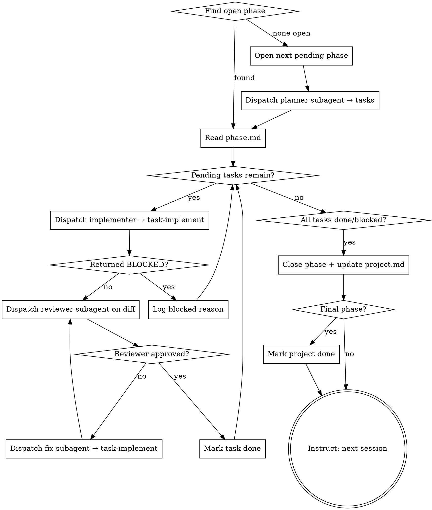

# Phase Execute

Supervises execution of a single project phase. Finds the current open phase, dispatches a subagent per task (each invoking `task-implement`), monitors results, and closes the phase when done. The executor never implements — it only supervises.

**The executor's context is expensive, and that is the reason to keep it lean.** It runs a long, many-turn loop (one dispatch + one or more review rounds per task), and every turn pays cache-read on its whole resident context. This is a *cost* argument, not a capability one — current models hold instruction-following and reasoning quality across a very long window, so the concern is tokens billed per turn, not degradation. So the executor never does heavy reasoning itself (task generation), never reads large outputs into its own context (full test logs, build output, big diffs), and never implements. All of that is pushed into short-lived subagents that return compact summaries. Bloat in the executor multiplies across every remaining turn of the loop.

## When to Use

- Starting a new session to work on a project with a `.tasks/` folder
- A phase was just opened by `project-orchestrate` or a prior phase just closed
- Resuming a phase that was partially completed

## Process



### Step 1 — Find the Current Phase

Scan `.tasks/` for a `phase.md` with `status: open`. If none found, find the next `status: pending` phase (lowest phase number) and set it `status: open`, `opened: <date>`.

If the phase already has task files, skip to Step 2 — do **not** regenerate them.

**If the phase has no task files yet, do not generate them inline.** Task generation is heavy reasoning (read `project.md`, read the spec, read the prior phase's outcomes, design the breakdown, write N files) and it would sit in the executor's context for the entire supervision loop. Push it into a one-shot **planner subagent** instead. The executor reads only the planner's one-line summary, not its reasoning.

Dispatch the planner, then re-read the now-populated `phase.md` (Step 2). Commit: `chore(phase-N): open — N tasks generated`.

**Planner subagent prompt template:**
```
You are planning one phase of an agentic project workflow. Generate the task files; do not implement anything.

Project file: <absolute path to .tasks/project.md>
Phase file:   <absolute path to .tasks/phase-N/phase.md>
Spec:         <absolute path to the spec under .tasks/specs/ that produced this phase, from project.md's ## Specs log>

Read project.md, the phase.md goal + exit criteria, and the spec. Also read the ## Notes of the most recent CLOSED phase's task files — later phases must build on what earlier phases actually learned.

If phase.md has a "## Carry from phase <N-1>" section, every numbered item in it is required work: turn each into a task (or fold it into one) and name the carry item it covers in that task's title or Context. "## Open follow-ups from phase <N-1>" items become tasks only when they fall inside this phase's goal; otherwise leave them listed.

Write one task file per unit of work into .tasks/phase-N/, named task-NN-<name>.md, using this exact format:
---
id: task-<NN>
title: <task title>
status: pending
complexity: <low|medium|high>
blocked-by: ~        # task-NN of any task this depends on, or ~
---
## Goal
## Context
## Acceptance Criteria
- [ ] <criterion>
## Notes

Then update phase.md's ## Tasks checklist to list the files you created. Keep tasks small and independently testable; set blocked-by honestly so the executor can order them.

Generate tasks for the phase goal as written — do not widen the phase's scope or add tasks for work a later phase owns.

Return ONE line only: "Generated M tasks for phase N: task-01-x, task-02-y, ...". No explanation, no preamble, no summary of how you decided.
```

### Step 2 — Read Phase Context

Read `phase.md` to load:
- Phase goal
- Exit criteria
- Task list (checked items = done, unchecked = pending/in-progress)

Read `.tasks/project.md` for overall project context.

### Step 3 — Dispatch Tasks

For each task file with `status: pending`, dispatch a subagent:

**Dispatch tuning by complexity:**
| complexity | model | effort (where the harness exposes it) |
|-----------|-------|----------------------------------------|
| low | claude-haiku-4-5-20251001 | low |
| medium | claude-sonnet-5 | medium |
| high | claude-opus-5 | xhigh |

**Reach for effort before reaching for a smaller model.** Low and medium effort hold quality at a fraction of the tokens and latency, so effort is the primary cost lever; a model downgrade trades away capability instead of just thinking tokens. Where the dispatch mechanism has no per-agent effort parameter (Claude Code's `Agent` tool exposes `model` but not `effort`; `Workflow`'s `agent()` exposes both), fall back to the model column alone and leave effort at the session default.

**Subagent prompt template:**
```
You are implementing a task in an agentic project workflow.

Project: <project title>
Phase <N>: <phase title>
Goal: <phase goal>

Task file: <absolute path to task-NN-name.md>

Invoke the `task-implement` skill to execute this task. Read the task file first to understand what's needed.

Implement test-first, as `task-implement` requires. Your returned status will be checked against the task file — the acceptance criteria and the tests backing them.

Deliver what the task file asks, at the scope intended. Make routine judgment calls yourself. If the task looks mistaken or a better approach exists, note it in one line under ## Notes and continue as asked — do not quietly narrow, widen, or transform it. Finish the whole task, and stop short of work clearly beyond it.

Implement the task yourself — do not delegate it onward, and do not spawn subagents to verify or double-check your own work.

When complete, return ONE line: a status token plus at most a short clause. No summary of the work — that belongs in the task file's ## Notes.
- DONE — task complete, acceptance criteria met
- DONE_WITH_CONCERNS — done but with issues noted in task Notes
- BLOCKED — could not complete, reason documented in task Notes
```

**Run tasks sequentially by default.** Only parallelize if tasks have no dependencies on each other (check `blocked-by` fields).

**Record the base commit** (`git rev-parse HEAD`) before dispatching each implementer — the Step 4 review diff is the range from that commit to `HEAD` after the task.

### Step 4 — Review Gate

The executor never accepts a returned DONE on its own. It dispatches an **independent reviewer subagent** — separate from the implementer, fresh context — and gates task completion on the reviewer's verdict.

1. **Triage the return.** Read the task file fresh. If the implementer returned `BLOCKED`, ensure the reason is in `## Notes`, commit `chore(task-NN): blocked — <title>`, and continue to the next task — no review needed. Otherwise confirm `status` was updated and the work was committed, then review.

2. **Build the diff.** Capture the task's commits as the range from the base commit recorded in Step 3 to current `HEAD`. The reviewer sees the diff, not the implementer's self-report.

3. **Dispatch the reviewer subagent** with the template below. It gets the task file (its acceptance criteria are the spec) and the diff.

   **Reviewer dispatch — scale down from the implementer.** Review is mostly judgment over a bounded diff, and review accuracy holds up well at lower effort, so a cheap fast pass per task is the right shape:
   | diff | model | effort |
   |------|-------|--------|
   | small, mechanical | claude-haiku-4-5-20251001 | low |
   | multi-file or subtle logic | claude-sonnet-5 | medium |

   Don't default the reviewer to the implementer's model — that silently doubles cost for no gain. The thorough pass happens later, at the phase's exit-criteria gate (Step 5).

   **Ask the reviewer for everything and filter here.** Never instruct it to "only report high-severity issues" or "be conservative" — it will comply literally and under-report. Severity filtering is the executor's job in step 4 below, not the reviewer's.

4. **Gate on the verdict:**
   - **APPROVED** (spec ✅, no Critical/Important issues): mark the task done, commit `chore(task-NN): done — <title>`, continue.
   - **CHANGES_REQUESTED:** dispatch a fix subagent — re-invoke `task-implement` on the same task file, handing it the reviewer's findings — then rebuild the diff and re-dispatch the reviewer. Loop until APPROVED. Never advance with open Critical/Important findings.
   - Record Minor findings in the task's `## Notes` for later; they don't block.

**Reviewer subagent prompt template:**
```
You are reviewing one task's implementation in an agentic project workflow. You did not write this code — review it independently.

Project: <project title>
Phase <N>: <phase title>

Task file: <absolute path to task-NN-name.md>
Diff to review: <commit range or diff file path>

The task file's ## Acceptance Criteria are the spec. Review ONLY the diff against them.

Report every issue you find at every severity — the executor filters, you do not. Do not withhold Minor findings.

Report:
- Spec: ✅ if every acceptance criterion is met and nothing beyond the task was built; ❌ with specifics otherwise.
- Quality: issues as Critical / Important / Minor. Flag missing or fake tests — the task required test-first development, so behavior must be backed by real tests that would fail without the change.
- Verdict: APPROVED (spec ✅, no Critical/Important) or CHANGES_REQUESTED with the findings list.

Keep the whole report under ~15 lines: one line per finding, each naming file:line and the problem. No code blocks, no restating the diff, no preamble.

Do not implement fixes. Do not soften or pre-rate severity to avoid a fix loop. Report exactly what you find.
```

### Step 5 — Close Phase

When all tasks are `done` or `blocked`:

0. **Verify exit criteria without running anything in the executor's context.** If `phase.md`'s exit criteria require a full-suite run, a build, or any command with bulky output, **dispatch a one-shot verifier subagent** — never run it in the supervisor session, where the output would bloat every remaining turn. The verifier runs the suite/build and returns only a compact verdict: `PASS`, or `FAIL` + the names of failing tests/checks (no full logs). If it returns FAIL, reopen the offending work as a fix task rather than closing the phase.

   **Verifier subagent prompt template:**
   ```
   You are verifying a phase's exit criteria. Run the checks; do not fix anything.

   Phase file: <absolute path to .tasks/phase-N/phase.md>
   Run the commands needed to confirm the ## Exit Criteria (test suite, build, lint as applicable).
   Return ONE compact verdict: "PASS", or "FAIL: <failing test/check names>". Do NOT paste full logs or stack traces.
   ```

1. **Write the carry-forward into the next phase's `phase.md`** (skip only if this is the final phase). Lessons and follow-ups scattered across task `## Notes` are invisible to the next session's planner, so gather them into two sections placed after the next phase's goal:
   - `## Carry from phase N` — numbered process/tooling fixes the next phase must make before or while it runs (each becomes a task when that phase is planned). One or two lines each, with the evidence that motivated it.
   - `## Open follow-ups from phase N` — loose ends that are not setup work: items to recheck later, unmerged candidates, decisions still waiting on the user, sessions or branches not to touch.

   Source them from this phase's task `## Notes`, reviewer Minor findings recorded there, and BLOCKED reasons. Write "none" under a heading rather than omitting it, so the next session knows it was considered. If the next phase does not exist yet, put both sections under a `## Carry-forward` heading in this phase's `phase.md` instead, for `project-orchestrate` to pick up.
2. Update `phase.md`: `status: closed`, `closed: <date>`
3. Update `project.md` task checklist for this phase: `- [x] Phase N: <title>`
4. Increment `current-phase` in `project.md`
5. Commit (the next phase's `phase.md` goes in the same commit): `chore(phase-N): closed`
6. Push

If this was the final phase: set `project.md` `status: done`, commit, push.

### Step 6 — Hand Off

Output to the human:

> Phase N complete. X tasks done, Y blocked.
> [If blocked tasks]: Review `.tasks/phase-N/` for blocked task details.
> Carry-forward: K items + L open follow-ups written to `.tasks/phase-N+1/phase.md`.
> Start a new session and invoke `phase-execute` for Phase N+1.

Or if project is done:
> Project complete. All phases closed. See `.tasks/project.md` for summary.

## Communicating During the Loop

The supervision loop is long and mostly mechanical, so narrate it thinly:

- **One sentence before the first dispatch**, naming the phase and task count.
- **During the loop, one line per task transition** — dispatched / approved / fix round N / blocked. Nothing else unless you change direction (reordering tasks, reopening work, hitting a systemic problem), in which case say why in one line.
- **Never echo a subagent's return into your own prose.** The task file and the commit log already hold it.
- **At phase close, lead with the outcome** — done/blocked counts first, supporting detail after.

Written files get the same discipline: `phase.md` and `project.md` edits are bookkeeping, not prose. Match their length to what the next session actually needs to read.

## Key Rules

- **Executor never implements** — all implementation work goes to subagents
- **Executor never generates tasks inline** — task generation is a one-shot planner subagent (Step 1); the executor reads only its one-line summary, never its reasoning
- **Executor never runs the suite or build in its own context** — exit-criteria checks go to a verifier subagent that returns a compact PASS/FAIL (Step 5); full logs never enter the supervisor session
- **Keep the executor's context lean** — it runs a many-turn loop and pays cache-read on its whole context every turn; push heavy reading/reasoning into subagents that return summaries
- **Review is an independent gate** — a separate, cheaper reviewer subagent (never the implementer, never the executor reading checkmarks) must approve each task before it closes; loop fixes until approved. This is a writer-verifier split across two agents, not an agent re-checking itself: implementers must never be told to self-verify or to spawn their own verifier
- **Effort before model downgrade** — when trimming cost, lower effort first and only then step down a model tier; cap subagent count structurally (one implementer + one reviewer per task) rather than leaving it to judgment
- **Every subagent prompt states its return shape and length** — planner one line, implementer one line, reviewer ~15 lines, verifier one verdict; an uncapped return lands in the executor's context and is re-read every remaining turn
- **Phases are the archive boundary** — never read or modify closed phases
- **Source of truth is `.tasks/`** — always read current file state, don't rely on memory
- **Commit every state change** — phase open, task done/blocked, phase close
- **Sequential by default** — only parallelize tasks with no `blocked-by` dependencies
