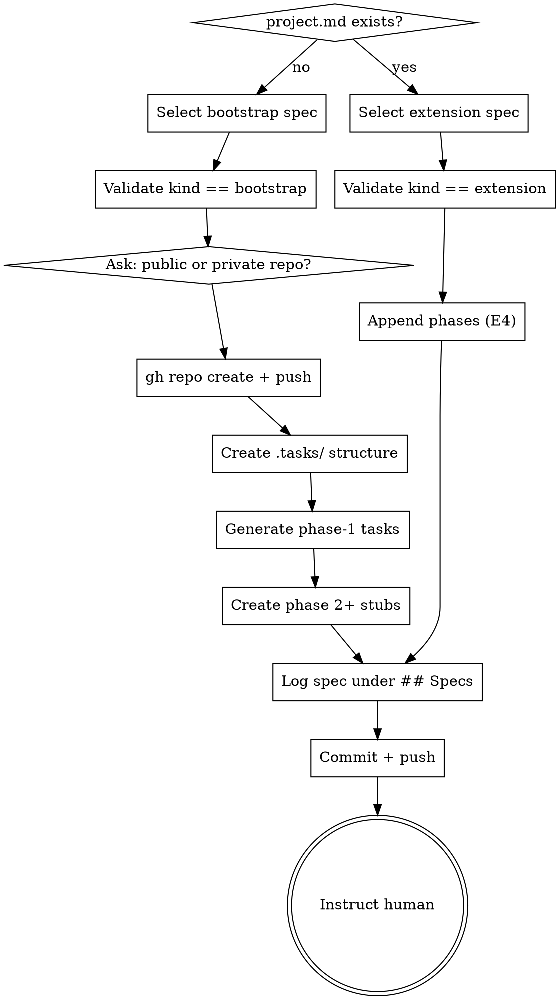

# Project Orchestrate

Sets up a persistent, git-tracked project workspace under `.tasks/` — a high-level plan split into phases, each phase into trackable task files. Designed for hand-off across multiple agent sessions. Also extends an existing `.tasks/` project by appending new phases (post-completion or mid-stream).

Input is a **dated spec** in `.tasks/specs/`, written by `agentflow:project-specify` (or by hand). Each spec is an immutable `YYYY-MM-DD-<slug>.md` file with a `kind:` frontmatter field. `project-orchestrate` selects one spec, builds phases from it, and records consumption in `project.md`'s `## Specs` log.

## When to Use

- Starting a new software project that will span multiple sessions (a `kind: bootstrap` spec exists in `.tasks/specs/`)
- A `.tasks/` project already exists and the user wants to append more phases (a `kind: extension` spec in `.tasks/specs/`)
- User wants multi-phase work with isolated phase execution

## Process

**Routing:** First action — check for `.tasks/project.md`. If absent, run the **Bootstrap** flow (Steps 1–6). If present, run the **Extension** flow (Steps E1–E5 in "Extending a Project" below). The flow determines which spec `kind` is expected; a `kind` that disagrees with the inferred mode is an error (see Edge Cases).



## Spec Selection

Both flows begin by selecting exactly one spec from `.tasks/specs/`. Selection is identical for bootstrap and extension; only the expected `kind` differs.

1. **Explicit path wins.** If the caller named a spec (e.g. "orchestrate `.tasks/specs/2026-06-17-auth.md`"), use that file.
2. **Else newest unconsumed spec.** Glob `.tasks/specs/*.md`. A spec is *consumed* if its path appears in `project.md`'s `## Specs` log (see below); on bootstrap there is no `project.md`, so every spec is unconsumed. Among unconsumed specs, pick the one with the newest `YYYY-MM-DD` filename prefix.
   - Exactly one unconsumed spec → use it.
   - Several unconsumed specs → list them and ask the user which to consume. Do not guess.
   - Zero unconsumed specs → fall back to the deprecated root file (`brief.md` for bootstrap, `extension.md` for extend); see "Deprecated fallbacks".
3. **Validate `kind` against mode.** Read the selected spec's frontmatter `kind`. Bootstrap mode expects `kind: bootstrap`; Extend mode expects `kind: extension`. A mismatch is an error — stop and report it, do not auto-fix (see Edge Cases).

Specs are **immutable history**: never edit or delete a spec after consuming it. Consumption is recorded only in `project.md`'s `## Specs` log.

### Spec file format

**Bootstrap spec** (`kind: bootstrap`):
```yaml
---
kind: bootstrap
title: My App
repo: private            # public | private
date: 2026-06-17
goal: |
  What the project builds and why.
phases:
  - name: Foundation
    goal: Set up database, auth, and core models
  - name: API Layer
    goal: REST endpoints for all resources
---
## Design
<approaches considered, the decision, rationale — the reviewable narrative>
```

**Extension spec** (`kind: extension`) — `title`/`repo` already live in `project.md`:
```yaml
---
kind: extension
date: 2026-07-02
phases:
  - name: UI Polish
    goal: Address feedback from user testing
    exit-criteria: |
      - All flagged issues resolved
---
## Notes
<free-form context to read before generating tasks>
```

The structured frontmatter fields drive `project-orchestrate`; the prose sections (`## Design`, `## Notes`) make the file double as the reviewable spec.

### Deprecated fallbacks

If `.tasks/specs/` has no usable unconsumed spec, fall back to a fixed-name root file, treated as **deprecated** (kept for backward compatibility only):

- Bootstrap → root `brief.md` (same fields as the bootstrap spec frontmatter, without `kind`).
- Extend → root `extension.md` (same `phases:` / `## Notes` shape as the extension spec).

Prefer dated specs. When a fallback file is used, note in the hand-off that the project should migrate to `.tasks/specs/`.

## Bootstrap Flow

### Step 1 — Select & Read the Bootstrap Spec

Run **Spec Selection** above, expecting `kind: bootstrap`. Read the selected spec's frontmatter and `## Design` section.

Capture `title`, `goal`, `repo` (`public` or `private`), and the `phases:` list. If `repo:` is missing, ask the user. If no spec and no `brief.md` fallback exist, interview the user:
- What is the project goal?
- What are the major phases? (e.g., Foundation → API → Frontend → Deploy)
- Any constraints (tech stack, deadlines, dependencies)?
- Public or private repo?

Remember the selected spec's path — it is logged in Step 5.

### Step 2 — Create GitHub Repo

```bash
gh repo create <project-name> --<private|public> --source=. --remote=origin --push
```

If the repo already exists remotely, just set the remote and push.

### Step 3 — Create `.tasks/` Structure

`.tasks/specs/` already exists (the spec lives there) — never clobber it.

**`project.md`:**
```yaml
---
title: <project title>
status: in-progress
current-phase: 1
repo: <private|public>
github: <repo URL>
created: <YYYY-MM-DD>
---
## Goal
<project goal>

## Phases
- [ ] Phase 1: Foundation
- [ ] Phase 2: API Layer

## Specs
```

The `## Specs` provenance log starts empty and is filled in Step 5.

**`phase-N/phase.md`** (one per phase):
```yaml
---
phase: <N>
title: <phase title>
status: open        # first phase only; rest are: pending
opened: <YYYY-MM-DD>  # first phase only
closed: ~
---
## Goal
<what this phase accomplishes>

## Exit Criteria
<what must be true before this phase closes>

## Tasks
- [ ] task-01-<name>.md
- [ ] task-02-<name>.md
```

### Step 4 — Generate Phase 1 Task Files

For phase 1 only, create individual task files. Subsequent phases get a `phase.md` stub only — tasks are generated when the phase opens (to stay relevant).

**`phase-1/task-NN-name.md`:**
```yaml
---
id: task-<NN>
title: <task title>
status: pending
complexity: <low|medium|high>
blocked-by: ~
---
## Goal
<what this task must accomplish>

## Context
<relevant background, links to related files or prior work>

## Acceptance Criteria
- [ ] <criterion 1>
- [ ] <criterion 2>

## Notes
```

**Complexity guidance:**
- `low` — straightforward, well-defined, < 30 min estimated
- `medium` — requires judgment or multiple files
- `high` — complex logic, cross-cutting concerns, or unknowns

### Step 5 — Log the Spec & Commit

Append the consumed spec to `project.md`'s `## Specs` log, recording path (relative to `.tasks/`), kind, and the phase range it produced:

```markdown
## Specs
- specs/2026-06-17-auth-system.md (bootstrap) → phases 1-3
```

If a deprecated `brief.md` fallback was used, record it as `brief.md (bootstrap) → phases 1-N`.

Commit message: `chore(tasks): init project — N phases, M tasks`

Push to the GitHub repo created in Step 2.

### Step 6 — Hand Off

Output to the human:

> Phase 1 is ready with M tasks. Start a new session in this directory and invoke `phase-execute` to begin execution.

## Extending a Project

Use this flow when `.tasks/project.md` already exists and the user wants to append new phases — either after the project was marked `done` or mid-stream while a phase is still open. Closed phases are never modified.

### Step E1 — Detect Extension Mode

Read `.tasks/project.md`. Its presence means Extend mode (expect `kind: extension`). Capture from frontmatter: `title`, `status`, `current-phase`. From `## Phases`, capture each entry and whether the checkbox is `[x]` or `[ ]`. Read the existing `## Specs` log so you know which specs are already consumed.

### Step E2 — Load Existing Phase State

Glob `.tasks/phase-*/phase.md`. Parse each frontmatter (`phase`, `title`, `status`, `opened`, `closed`). Compute the highest existing phase number `K` from the `phase:` field — do **not** rely on folder lexical sort (`phase-10` would sort before `phase-2`). Note whether any phase has `status: open`.

### Step E3 — Select the Extension Spec

Run **Spec Selection** above, expecting `kind: extension`. Read the selected spec's `phases:` list and any `## Notes` section.

If no unconsumed spec and no `extension.md` fallback exist, interview the user:
- "What new work needs to happen?"
- "How would you split it into phases (if more than one)?"
- "Any exit criteria for each?"

Remember the selected spec's path — it is logged in Step E5.

### Step E4 — Append Phases

For each new phase, numbering from `K+1`:

- Append `- [ ] Phase N: <title>` to `## Phases` in `.tasks/project.md`.
- Create `.tasks/phase-N/phase.md` with `status: pending`, `opened: ~`, `closed: ~`, the goal, exit criteria, and an **empty Tasks list**. Do not pre-generate task files — `phase-execute` generates them when it opens the phase.
- Update `.tasks/project.md` frontmatter:
  - If `status: done`, flip to `status: in-progress`.
  - Set `current-phase` to the lowest phase number with `status: open` or `status: pending`. If a phase is already open, leave `current-phase` on it; otherwise it becomes `K+1`.
- Do not modify any closed phase's files or `closed:` date. Do not modify task files inside closed phases.

### Step E5 — Log the Spec, Commit, Push, Hand Off

- Append the consumed extension spec to `project.md`'s `## Specs` log:
  ```markdown
  - specs/2026-07-02-billing.md (extension) → phases 4-5
  ```
  If a deprecated `extension.md` fallback was used, record it as `extension.md (extension) → phases K+1-K+N`.
- **Do not delete the spec.** Specs are immutable history; the `## Specs` log marks it consumed so a later run won't reapply it. (A deprecated root `extension.md` fallback *may* be deleted after use, since it has no dated identity and would otherwise be re-detected; prefer migrating it into `.tasks/specs/`.)
- Commit: `chore(tasks): extend with N phase(s) — <comma-separated titles>`.
- Push.
- Output to the human:

> Added Phase K+1..K+N. Start a new session and invoke `phase-execute` to begin.

## Edge Cases

- **Multiple unconsumed specs** — list them with their dates/kinds and ask the user which to consume; never auto-pick more than the single newest, and never consume more than one spec per run.
- **`kind` / mode mismatch** — a `kind: extension` spec selected in Bootstrap mode (no `project.md`), or a `kind: bootstrap` spec selected in Extend mode (`project.md` exists), is an error. Stop and report: *"Spec kind '<kind>' does not match inferred mode '<mode>'."* Do not auto-fix or re-route.
- **Mid-stream extension while a phase is open** — append after the open phase. Don't touch the open phase or its tasks. `current-phase` stays on the open phase.
- **Extension spec exists but `.tasks/project.md` doesn't** — error with: *"Found a kind: extension spec but no .tasks/ project. Did you mean a bootstrap spec?"* Do not auto-rename or proceed. (Same for a deprecated root `extension.md`.)
- **Already-consumed spec named explicitly** — if the user names a spec already in the `## Specs` log, confirm before reprocessing; re-consuming would duplicate phases.
- **Project status was `done`** — flip to `in-progress`. Leave closed phases' `closed:` dates intact and untouched.
- **User wants tasks pre-filled in the new phase** — out of scope. Tasks are deferred to `phase-execute`. If the user wants explicit task control, they can edit `phase-N/phase.md` after the skill runs.

## Key Rules

- **One spec per run** — each orchestrate run consumes exactly one spec and logs it under `## Specs`.
- **Specs are immutable** — never edit or delete a dated spec in `.tasks/specs/`; consumption is tracked in `project.md`, not by deleting the file.
- **Never generate task files for future phases** at project start — they will be created when the phase opens, based on what was learned in prior phases.
- **Phases are the archive boundary** — closed phases are never touched again by executors.
- **`.tasks/` is the single source of truth** — any agent in any session can reconstruct full project state by reading it, including which specs were consumed.
