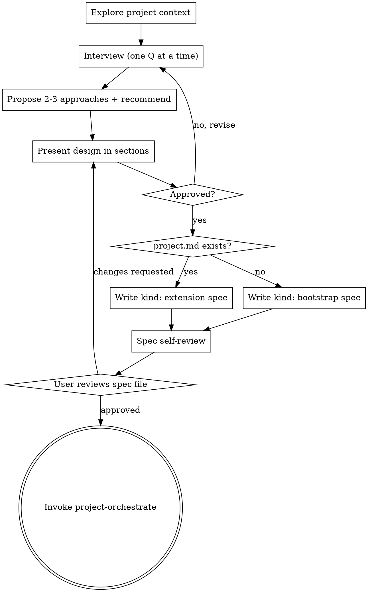

# Project Specify

Owns the design dialogue at the front of the agentflow pipeline. Runs a disciplined interview, proposes approaches, presents a design for approval, writes an immutable dated spec to `.tasks/specs/`, and hands off to `agentflow:project-orchestrate` — which converts the spec into the `.tasks/` phased structure.

It is the design front-end of the agentflow pipeline: the disciplined dialogue happens here, and its single hard-coded terminal state is `agentflow:project-orchestrate`, so a raw idea flows straight into the phased `.tasks/` structure without any manual hand-off.

## When to Use

- A user wants to start a new software project ("let's build X", "new project").
- A user wants to add a substantial new capability to an existing `.tasks/` project ("new feature", "extend the project").
- Any "design this / spec this out / plan this project" request that should end in agentflow's `.tasks/` workflow.

<HARD-GATE>
Do NOT implement, scaffold, create repos, write code, or invoke `agentflow:project-orchestrate` until BOTH of these are true:
1. The design has been presented to the user in sections AND approved.
2. The written spec file in `.tasks/specs/` has been reviewed by the user and approved.

Until then, the only allowed actions are: reading context, interviewing, proposing approaches, presenting the design, and writing the spec for review. No state beyond `.tasks/specs/<spec>.md` may be created. Asking for clarification is always allowed; building is not.
</HARD-GATE>

## Process



### Step 1 — Explore Context

Before asking anything, gather what already exists so questions are informed, not generic:

- Read `README.md`, `CLAUDE.md`, and any obvious docs.
- Check for `.tasks/project.md` — its presence decides the spec `kind` (see Step 5).
- Skim recent commits (`git log --oneline -20`) and the directory layout.
- If `.tasks/specs/` exists, note prior specs for naming/style continuity.

Summarize what you found in one or two sentences before interviewing, so the user can correct wrong assumptions early.

### Step 2 — Interview, One Question at a Time

Run a disciplined interview. **Ask exactly one question per turn** and wait for the answer before the next. **Prefer multiple-choice** ("A / B / C, or something else?") — it's faster for the user and surfaces options they hadn't considered.

Cover, across several turns:

- **Purpose** — what is being built and for whom; what problem it solves.
- **Constraints** — tech stack, deadlines, dependencies, must-not-do's.
- **Success criteria** — what "done" looks like; how it's verified.
- **Scope boundaries** — explicit non-goals (YAGNI).

Do not batch these into one wall of questions. Stop interviewing once you can describe the project back accurately.

### Step 3 — Propose Approaches

Propose **2–3 distinct approaches** with honest trade-offs (effort, risk, flexibility, fit to constraints). End with **one clear recommendation** and the reasoning. Let the user pick or steer; don't proceed on the recommendation silently.

### Step 4 — Present the Design in Sections

Present the design as labeled sections, scaled to the project's complexity (e.g. Architecture, Data Model, Phases, Risks). **Get explicit approval after each section** rather than dumping the whole design and asking once. Revise on feedback and re-present. Do not move to writing the spec until the design as a whole is approved.

Keep each section short enough to review in one sitting — a few tight paragraphs or a bullet list, not an essay. Spend the words on the decision and its consequences; keep caveats and disclaimers brief. A section the user skims because it's long has not actually been approved.

### Step 5 — Detect Mode & Write the Spec

**Mode is inferred from state:**

- `.tasks/project.md` **absent** → this is a new project → write a **`kind: bootstrap`** spec.
- `.tasks/project.md` **present** → this extends an existing project → write a **`kind: extension`** spec.

Create `.tasks/specs/` if it does not exist. Write the spec to **`.tasks/specs/YYYY-MM-DD-<slug>.md`**:

- Date prefix = today (`YYYY-MM-DD`).
- `<slug>` = the title lowercased, spaces→hyphens, non-alphanumerics stripped (e.g. "Auth System" → `auth-system`).
- **Never overwrite an existing spec.** Specs are immutable history. If the target filename already exists, disambiguate the slug (e.g. add a qualifier) rather than clobbering.

The spec format below is the **input contract consumed by `agentflow:project-orchestrate`** — the structured frontmatter fields drive phase generation; the prose section makes the file double as the reviewable spec. Match it exactly.

**Bootstrap spec** (`kind: bootstrap`):
```yaml
---
kind: bootstrap
title: My App
repo: private            # public | private
date: 2026-06-17
goal: |
  What the project builds and why.
phases:
  - name: Foundation
    goal: Set up database, auth, and core models
  - name: API Layer
    goal: REST endpoints for all resources
---
## Design
<approaches considered, the decision, rationale — the reviewable narrative>
```

**Extension spec** (`kind: extension`) — `title`/`repo` already live in `project.md`, so they are omitted:
```yaml
---
kind: extension
date: 2026-07-02
phases:
  - name: UI Polish
    goal: Address feedback from user testing
    exit-criteria: |
      - All flagged issues resolved
---
## Notes
<free-form context to read before generating tasks>
```

Field rules:
- `kind` — `bootstrap` or `extension`; must match the inferred mode.
- `title` — bootstrap only; the project name. Drives the GitHub repo name and `project.md` title.
- `repo` — bootstrap only; `public` or `private`. If the user hasn't said, ask (one question) before writing.
- `date` — today, `YYYY-MM-DD`.
- `goal` — bootstrap only; a short block-scalar summary of what/why.
- `phases` — a list of `{ name, goal }` entries (extension entries may add `exit-criteria`). Order is execution order. This is what `project-orchestrate` turns into phase folders.
- Prose section — `## Design` for bootstrap, `## Notes` for extension. This is the human-reviewable narrative; capture the approaches considered and the decision.

### Step 6 — Spec Self-Review

Before showing the user, review your own spec for:

- **Placeholders** — no leftover `<...>`, `TODO`, or example values from the templates.
- **Internal consistency** — `kind` matches the inferred mode; `title`/`repo` present iff bootstrap; phase goals align with the prose design.
- **Scope** — phases cover the agreed scope and nothing beyond it (respect stated non-goals).
- **Ambiguity** — each phase goal is concrete enough for `project-orchestrate` to derive tasks.
- **Length** — the prose section covers the substance without padding: no filler sections, no redundant summary of the frontmatter, no boilerplate. The spec is read by every downstream planner subagent, so length here is paid for repeatedly.

Fix anything that fails before proceeding.

### Step 7 — User Reviews the Spec File

Tell the user the spec path and ask them to read it and approve. If they request changes, revise the spec (and re-present the affected design sections if the change is substantive), then ask again. **Do not pass the HARD-GATE without explicit approval of the written file.**

### Step 8 — Terminal Handoff

Once the spec is approved, **invoke `agentflow:project-orchestrate`, passing the spec path** (e.g. "orchestrate `.tasks/specs/2026-06-17-auth-system.md`"). `project-orchestrate` selects the spec, builds the `.tasks/` structure, and logs consumption in `project.md`'s `## Specs` log.

The hard-coded terminal state is `agentflow:project-orchestrate` and nothing else. Do not route the approved design into any other planner, and do not start implementing tasks yourself — that is `phase-execute`.

## Key Rules

- **HARD-GATE is absolute** — no building, scaffolding, repo creation, or orchestrate handoff until the design is approved AND the written spec is approved.
- **One question at a time** — interview, never interrogate; multiple-choice preferred.
- **Recommend, don't decide** — always offer 2–3 approaches and let the user steer.
- **Specs are immutable** — write a new dated file; never overwrite a prior spec in `.tasks/specs/`.
- **Mode is inferred, not asked** — `.tasks/project.md` absent ⇒ bootstrap, present ⇒ extension; the `kind` field must agree.
- **The spec is the contract** — its frontmatter must match exactly what `agentflow:project-orchestrate` reads (`kind`, `title`/`repo`/`goal`/`phases` for bootstrap; `phases`/`## Notes` for extension).
- **Terminal state is `project-orchestrate`** — hand the approved spec off there and nowhere else; don't advance work in this skill.
